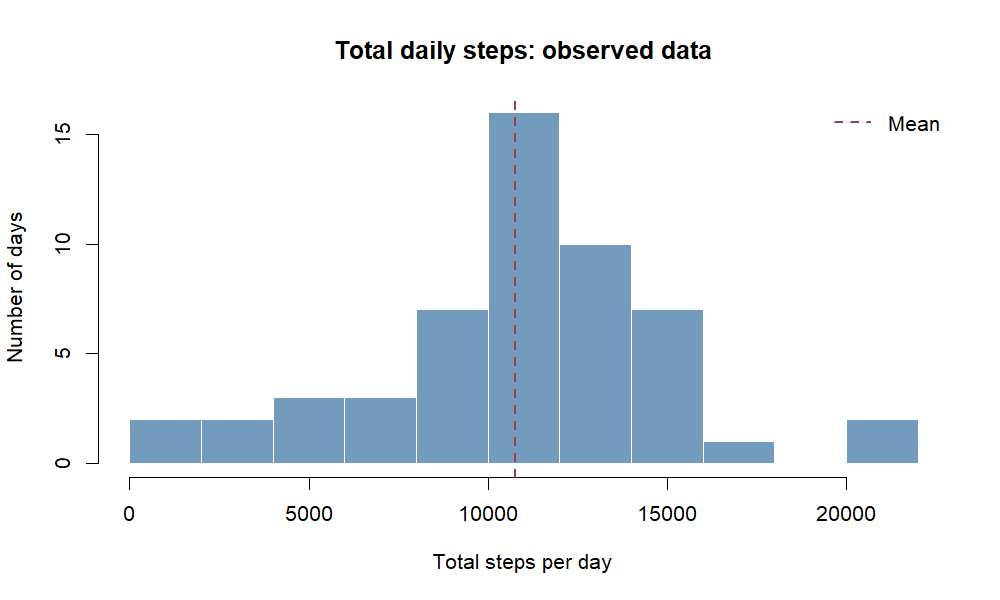
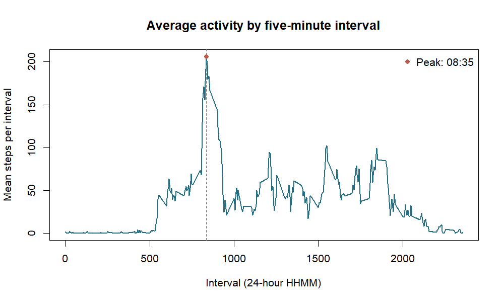
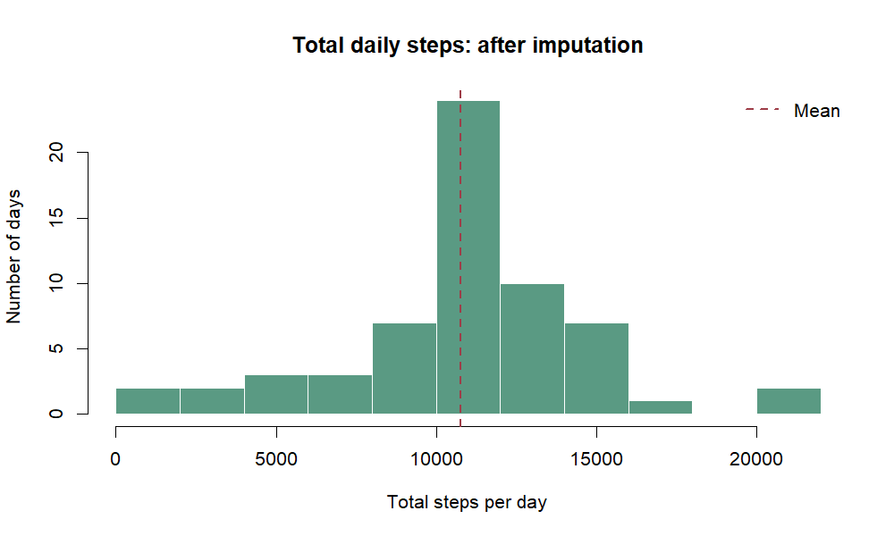
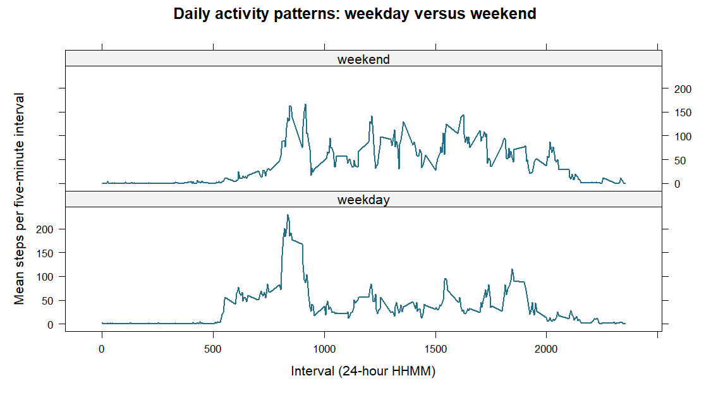

# Reproducible Research — Peer Assessment 1

**Activity Monitoring Data: Daily Steps, Missingness, and Activity Patterns**

## Introduction

This report analyses step counts recorded at five-minute intervals for one anonymous participant during October and November 2012. We examine daily totals, the average activity profile throughout the day, the effect of missing observations, and differences between weekdays and weekends. All figures, statistics, and conclusions are generated directly from the supplied dataset using reproducible R code.


``` r
# Required packages: knitr and lattice (lattice is usually bundled with R).
library(knitr)
library(lattice)
knitr::opts_chunk$set(echo = TRUE, warning = FALSE, message = FALSE,
                      fig.path = "figure/", fig.width = 8,
                      fig.height = 4.8, dpi = 125)
```

## 1. Loading and preprocessing the data

The original data contain three columns: `steps`, `date`, and `interval`. An interval value such as `835` denotes the five-minute interval beginning at 08:35. Missing step counts are represented by `NA`. The repository contains `activity.zip`; the code also supports an already-extracted `activity.csv`.


``` r
if (file.exists("activity.csv")) {
  activity <- read.csv("activity.csv", stringsAsFactors = FALSE)
} else if (file.exists("activity.zip")) {
  activity <- read.csv(unz("activity.zip", "activity.csv"),
                       stringsAsFactors = FALSE)
} else {
  stop("Missing activity.csv / activity.zip. Run from the repository root.")
}

activity$date <- as.Date(activity$date, format = "%Y-%m-%d")
activity$interval <- as.integer(activity$interval)
activity$steps <- as.numeric(activity$steps)

stopifnot(nrow(activity) == 17568L,
          !anyNA(activity$date),
          !anyNA(activity$interval),
          all(c("steps", "date", "interval") %in% names(activity)))

str(activity)
```

```
## 'data.frame':	17568 obs. of  3 variables:
##  $ steps   : num  NA NA NA NA NA NA NA NA NA NA ...
##  $ date    : Date, format: "2012-10-01" "2012-10-01" "2012-10-01" ...
##  $ interval: int  0 5 10 15 20 25 30 35 40 45 ...
```

``` r
head(activity)
```

```
##   steps       date interval
## 1    NA 2012-10-01        0
## 2    NA 2012-10-01        5
## 3    NA 2012-10-01       10
## 4    NA 2012-10-01       15
## 5    NA 2012-10-01       20
## 6    NA 2012-10-01       25
```

``` r
cat("Rows:", nrow(activity), "\n")
```

```
## Rows: 17568
```

``` r
cat("Dates:", length(unique(activity$date)), "\n")
```

```
## Dates: 61
```

``` r
cat("Five-minute intervals:", length(unique(activity$interval)), "\n")
```

```
## Five-minute intervals: 288
```

The dataset contains **17,568 records**, covering **61 days** with **288 time intervals per day**.

## 2. Mean total number of steps taken per day

For the first analysis, we omit rows with missing step counts. Dates for which *all* step counts are missing are consequently not assigned a zero total, because zero would incorrectly indicate no physical activity rather than missing measurement.


``` r
observed <- activity[!is.na(activity$steps), ]
daily_original <- aggregate(steps ~ date, data = observed, FUN = sum)
original_mean <- mean(daily_original$steps)
original_median <- median(daily_original$steps)

cat("Days with observed steps:", nrow(daily_original), "\n")
```

```
## Days with observed steps: 53
```

``` r
cat("Mean steps/day:", original_mean, "\n")
```

```
## Mean steps/day: 10766.19
```

``` r
cat("Median steps/day:", original_median, "\n")
```

```
## Median steps/day: 10765
```


``` r
hist(daily_original$steps,
     breaks = 12,
     col = "#739BBE", border = "white",
     main = "Total daily steps: observed data",
     xlab = "Total steps per day", ylab = "Number of days")
abline(v = original_mean, col = "#9E3D48", lwd = 2, lty = 2)
legend("topright", legend = "Mean", col = "#9E3D48", lty = 2,
       lwd = 2, bty = "n")
```



The mean daily total is **10766.19 steps** and the median is **10765.00 steps**. These values are calculated from the 53 days with at least one observed step measurement; they are not estimates from days containing only missing values.

## 3. Average daily activity pattern

We average the observed step count over all days for each of the 288 five-minute intervals, excluding missing observations from each interval's mean.


``` r
interval_means <- aggregate(steps ~ interval, data = observed, FUN = mean)
max_row <- which.max(interval_means$steps)
max_interval <- interval_means$interval[max_row]
max_average <- interval_means$steps[max_row]
peak_time <- sprintf("%02d:%02d", max_interval %/% 100,
                     max_interval %% 100)
cat("Peak interval:", max_interval, "(", peak_time, ")\n")
```

```
## Peak interval: 835 ( 08:35 )
```

``` r
cat("Average steps in that interval:", max_average, "\n")
```

```
## Average steps in that interval: 206.1698
```


``` r
plot(interval_means$interval, interval_means$steps,
     type = "l", lwd = 2, col = "#246F86",
     main = "Average activity by five-minute interval",
     xlab = "Interval (24-hour HHMM)",
     ylab = "Mean steps per interval")
abline(v = max_interval, lty = 2, lwd = 1.5, col = "#B85D4E")
points(max_interval, max_average, pch = 19, col = "#B85D4E")
legend("topright", legend = paste("Peak:", peak_time),
       col = "#B85D4E", pch = 19, bty = "n")
```



The highest average activity occurs in interval **835 (08:35)**, with **206.17 steps per five-minute interval**.

## 4. Imputing missing values

### 4.1 Extent of missing data


``` r
missing_count <- sum(is.na(activity$steps))
missing_percent <- 100 * missing_count / nrow(activity)
fully_missing_days <- sum(vapply(
  split(activity$steps, activity$date),
  function(x) all(is.na(x)),
  logical(1)
))

cat("Missing step values:", missing_count, "\n")
```

```
## Missing step values: 2304
```

``` r
cat("Missing percentage:", round(missing_percent, 2), "%\n")
```

```
## Missing percentage: 13.11 %
```

``` r
cat("Entirely missing days:", fully_missing_days, "\n")
```

```
## Entirely missing days: 8
```

There are **2,304 missing step measurements** (13.11% of observations). There are **8 entirely missing days**. Treating their missing measurements as zero would underestimate their activity.

### 4.2 Imputation method

We replace every missing value with the **mean step count for the same five-minute interval across other days**, as calculated in Section 3. This preserves the observed mean time-of-day profile rather than assigning every missing interval the same overall average. It is a simple, deterministic method, but it cannot recover unusual activity on the missing days.


``` r
activity_imputed <- activity
missing_rows <- is.na(activity_imputed$steps)
interval_lookup <- match(activity_imputed$interval[missing_rows],
                         interval_means$interval)
activity_imputed$steps[missing_rows] <- interval_means$steps[interval_lookup]

stopifnot(!anyNA(activity_imputed$steps),
          nrow(activity_imputed) == nrow(activity),
          identical(activity$date, activity_imputed$date),
          identical(activity$interval, activity_imputed$interval),
          identical(activity$steps[!missing_rows],
                    activity_imputed$steps[!missing_rows]))

cat("Missing step values after imputation:",
    sum(is.na(activity_imputed$steps)), "\n")
```

```
## Missing step values after imputation: 0
```

### 4.3 Changes to daily totals


``` r
daily_imputed <- aggregate(steps ~ date, data = activity_imputed,
                           FUN = sum)
imputed_mean <- mean(daily_imputed$steps)
imputed_median <- median(daily_imputed$steps)

summary_table <- data.frame(
  Analysis = c("Observed data", "After imputation"),
  Days = c(nrow(daily_original), nrow(daily_imputed)),
  Mean_steps = c(original_mean, imputed_mean),
  Median_steps = c(original_median, imputed_median)
)
knitr::kable(summary_table, digits = 2,
             caption = "Daily step totals before and after imputation")
```


Table: Daily step totals before and after imputation

|Analysis         | Days| Mean_steps| Median_steps|
|:----------------|----:|----------:|------------:|
|Observed data    |   53|   10766.19|     10765.00|
|After imputation |   61|   10766.19|     10766.19|

``` r
cat("Change in mean:", round(imputed_mean - original_mean, 2), "\n")
```

```
## Change in mean: 0
```

``` r
cat("Change in median:", round(imputed_median - original_median, 2), "\n")
```

```
## Change in median: 1.19
```


``` r
hist(daily_imputed$steps,
     breaks = 12,
     col = "#5A9A83", border = "white",
     main = "Total daily steps: after imputation",
     xlab = "Total steps per day", ylab = "Number of days")
abline(v = imputed_mean, col = "#9E3D48", lwd = 2, lty = 2)
legend("topright", legend = "Mean", col = "#9E3D48", lty = 2,
       lwd = 2, bty = "n")
```



After imputation, the analysis contains **61 days** rather than 53. The mean is **1.076619 &times; 10<sup>4</sup> steps/day** (a change of 0), and the median is **1.076619 &times; 10<sup>4</sup> steps/day** (a change of 1.19). The imputation makes all daily totals calculable, but the filled-in observations are estimates, not new measurements. In particular, using the mean profile can reduce the apparent variability in the distribution of daily totals.

## 5. Weekday versus weekend activity patterns

We classify days using the numeric weekday returned by `as.POSIXlt()`: 0 is Sunday and 6 is Saturday. This is independent of the computer's language setting and avoids locale-specific `weekdays()` strings. The analysis uses **only the imputed dataset**.


``` r
weekday_number <- as.POSIXlt(activity_imputed$date)$wday
activity_imputed$day_type <- factor(
  ifelse(weekday_number %in% c(0, 6), "weekend", "weekday"),
  levels = c("weekday", "weekend")
)

by_day_type <- aggregate(steps ~ interval + day_type,
                         data = activity_imputed, FUN = mean)

# Additional descriptive comparison: mean TOTAL daily steps in each group.
daily_by_day_type <- aggregate(steps ~ date + day_type,
                               data = activity_imputed, FUN = sum)
mean_daily_by_type <- aggregate(steps ~ day_type,
                                data = daily_by_day_type, FUN = mean)
knitr::kable(mean_daily_by_type, digits = 2,
             col.names = c("Day type", "Mean steps per day"))
```


|Day type | Mean steps per day|
|:--------|------------------:|
|weekday  |           10255.85|
|weekend  |           12201.52|


``` r
print(lattice::xyplot(
  steps ~ interval | day_type,
  data = by_day_type,
  type = "l", layout = c(1, 2),
  col = "#246F86", lwd = 2,
  main = "Daily activity patterns: weekday versus weekend",
  xlab = "Interval (24-hour HHMM)",
  ylab = "Mean steps per five-minute interval",
  scales = list(y = list(relation = "same"))
))
```



The two panels show how the **timing and intensity of activity** differ between weekdays and weekends. The mean daily total is 1.025585 &times; 10<sup>4</sup> steps on weekdays and 1.220152 &times; 10<sup>4</sup> steps on weekends. The shared vertical scale makes the plotted profiles directly comparable.

## Conclusions and limitations

1. We estimated the distribution, mean, and median of observed daily step totals without treating missing days as inactive days.
2. The average five-minute activity profile identified the interval of maximum recorded activity.
3. Missing measurements were replaced systematically with time-specific averages, after which all dates had computable totals; the before/after summary quantifies the resulting changes.
4. The weekday/weekend panel compares activity timing using the completed dataset.

**Limitations.** This dataset records one anonymous individual over two months, so the findings are descriptive rather than population-level. Interval-mean imputation assumes a stable daily activity pattern and can conceal true day-to-day variation. No causal inference is intended.

**Data source:** Activity monitoring dataset distributed with the Johns Hopkins University Reproducible Research Peer Assessment 1, `rdpeng/RepData_PeerAssessment1`.
